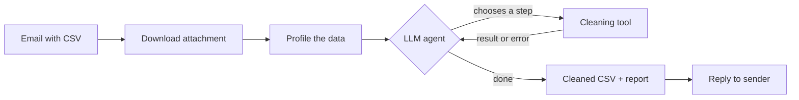

# LLM Data-Cleaning Agent — Gmail CSV Automation

## About the project

An automation that cleans messy CSV files sent by email. You email a CSV to a Gmail
account, and an **LLM agent** inspects the data, decides which cleaning steps are needed,
runs them, and replies with the cleaned file and a plain-English explanation of what it
changed and why.

It is built with Python, Pandas, LangGraph and the Gmail API.

## Pipeline



**1. Fetch** — The script searches Gmail for unread emails that have a CSV attachment and
downloads the file.

**2. Profile** — The data is summarised for the agent: number of rows and columns, column
types, missing values, duplicate rows and a few sample values per column.

**3. Plan and clean (the agent loop)** — A LangGraph agent repeats this cycle:
*plan → call a tool → read the result → decide the next step*. It works column by column,
for example converting dates, parsing prices, merging spellings of the same category,
filling or leaving missing values. If a tool refuses an action, the agent reads the error
and changes its plan. When the file is ready it calls `finish_cleaning` with a summary.

**4. Report and reply** — The cleaned CSV is sent back to the sender, together with the
agent's summary and the list of steps it took, each with its reason. The email is then
labelled `Automation-Processed` and marked as read. If something fails, it is labelled
`Automation-Failed`.

## Cleaning tools

The agent can only use these tools, never free-form code.

| Tool | Purpose |
|---|---|
| `profile_data` | Re-check the current state of the data |
| `normalize_column_names` | `' Order Amount ($) '` → `order_amount` |
| `clean_text_values` | Trim spaces, turn `NA`, `null`, `-`, `?` into missing values |
| `drop_empty_rows_and_columns` | Remove completely empty rows and columns |
| `drop_duplicate_rows` | Remove exact duplicate rows |
| `convert_to_numeric` | Parse numbers with currency symbols and commas |
| `convert_to_date` | Parse dates to `YYYY-MM-DD` (day-first or month-first) |
| `standardize_case` | Make categories consistent (`cairo`, `CAIRO` → `Cairo`) |
| `fill_missing_values` | Median, mean, mode, "Unknown" or leave, per column |
| `drop_column` | Drop mostly-empty columns |
| `finish_cleaning` | End the run with an explanation |

## Safety checks

- Only the tools above can run; the original data is never modified.
- Tools validate themselves: IDs and phone numbers with leading zeros stay text,
  a column converts to numbers or dates only if at least 90% of its values parse,
  and a column is dropped only if at least half of it is missing.
- The agent is limited to 30 steps.
- If the agent fails or makes no changes, a standard rule-based cleaning is used instead,
  so the sender always gets a reply.

## Tech stack

Python · Pandas · LangGraph · LangChain · Gmail API · Gemini / Claude / OpenAI (any one)

## Setup

```bash
pip install -r requirements.txt
```

1. **Gmail API:** in Google Cloud, enable the Gmail API, create OAuth *Desktop* credentials
   and save the file as `credentials.json` in this folder.
2. **LLM key:** set the key for your provider in the terminal, for example for Gemini:
   ```powershell
   $env:GOOGLE_API_KEY="your-key"
   ```
   To use another provider set `LLM_PROVIDER` to `anthropic` or `openai`
   and the matching key (`ANTHROPIC_API_KEY` / `OPENAI_API_KEY`).

## Run

```bash
python email_csv_cleaning_automation.py
```

The first run opens a browser to authorise Gmail. Then email a CSV to that account and
run the script again: it replies with the cleaned file.

## Project files

| File | Purpose |
|---|---|
| `email_csv_cleaning_automation.py` | Gmail integration (fetch, reply, labels) |
| `cleaning_agent.py` | The LangGraph agent, its tools and safety checks |
| `eval_agent.py` | Test files with known answers to measure cleaning accuracy |
| `requirements.txt` | Python dependencies |

## Limitations

- Only `.csv` attachments are supported.
- A profile and sample values of each file are sent to the LLM provider, so avoid
  confidential data.
- Never upload `credentials.json` or `token.json` to GitHub (they are in `.gitignore`).
